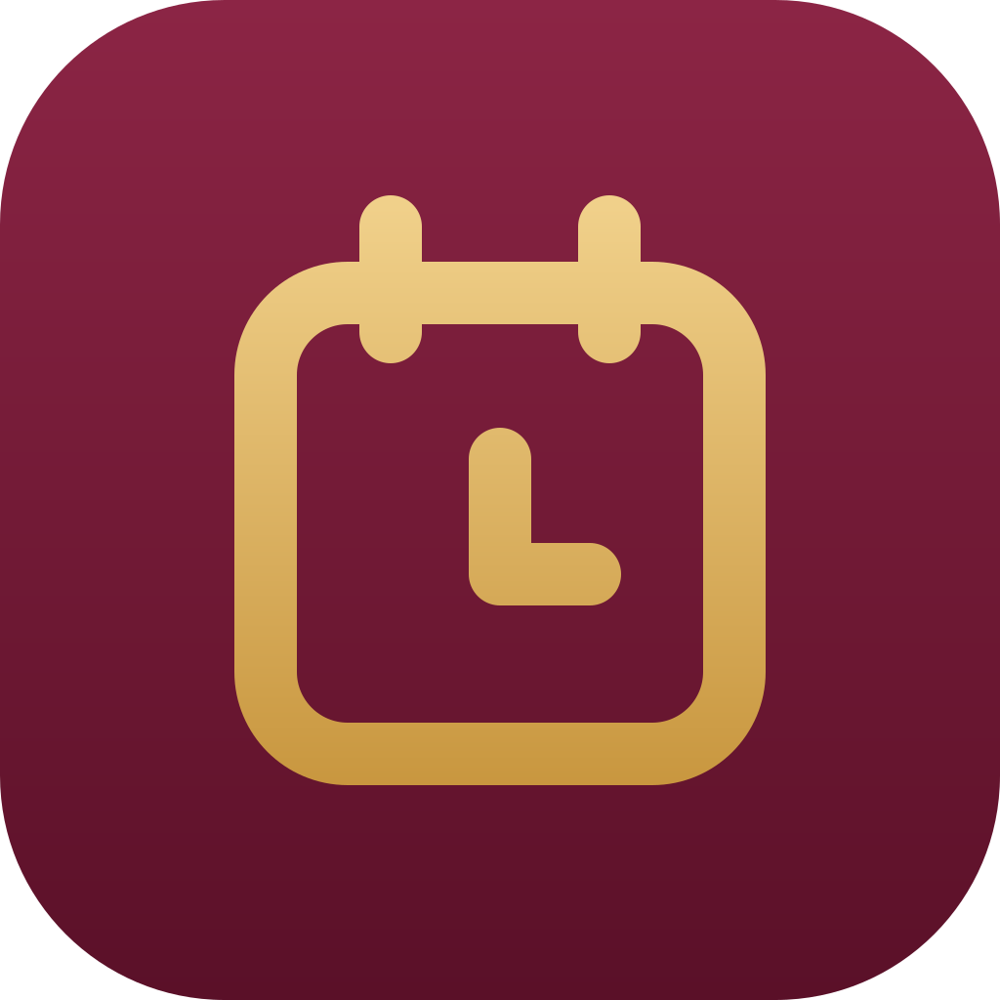

# Zeitnachweis

Web-App des Familien-App-Studios: Aus einem Foto vom Zeitnachweis werden Kalendereinträge für die Arbeitszeiten.

1. Foto vom Zeitnachweis auswählen oder aufnehmen (Ausdruck oder Bildschirm).
2. Die erkannten Schichten prüfen. Das Foto lässt sich dazu groß ansehen und zoomen. Lernzeit wird als eigener Termin „Lernzeit“ übernommen.
3. Eintragen: als Kalenderdatei (.ics) für Apple Kalender oder direkt in Google Kalender.

## Aufbau

- `public/`: die App (HTML, CSS, JavaScript ohne Build-Schritt), Manifest, Service Worker, Icons
- `api/config.js`: öffentliche Einstellungen und Kontoprüfung
- `api/erkennen.js`: liest die Schichten aus dem Foto (Google Gemini), nur für angemeldete, freigeschaltete Konten
- `api/ics.js`: liefert die geprüften Schichten als Kalenderdatei; die App speichert sie nicht, sie stehen aber in der Adresse (Browser-Verlauf, Zugriffsprotokoll)
- `lib/`: gemeinsame Logik (Kalenderdatei, Prüfung der Erkennung, Anmeldung)
- `brand/`: Quell-SVGs des App-Icons
- `test/`: Unit-Tests (`npm test`)
- `tools/dev-server.js`: kleiner Server zum Ausprobieren (`npm run dev`)

## Einrichtung bei Vercel (Umgebungsvariablen)

| Name | Inhalt |
|---|---|
| `GOOGLE_CLIENT_ID` | OAuth-Client-ID (Typ „Webanwendung“) aus der Google Cloud Console |
| `ALLOWED_EMAILS` | freigeschaltete Google-Konten, durch Komma getrennt |
| `GEMINI_API_KEY` | Schlüssel aus Google AI Studio (geheim; bei Vercel als „Sensitive“ und nur für Production) |
| `GEMINI_MODEL` | optional; ohne Angabe probiert die App die aktuellen Flash-Modelle der Reihe nach |

Ohne `GOOGLE_CLIENT_ID` und `ALLOWED_EMAILS` läuft die App ohne Anmeldung: Schichten von Hand und Kalenderdatei gehen, Foto-Erkennung und Google Kalender sind aus.

In der Google Cloud Console braucht die Client-ID die Adresse der App als „Autorisierte JavaScript-Quelle“. Für Google Kalender muss die Google Calendar API aktiviert sein; die App fragt die Berechtigungen `calendar.events` und `calendar.calendarlist.readonly` erst beim Eintragen ab.

## Datenschutz

- Das Foto geht nur für die Erkennung an Google Gemini und wird von der App nicht gespeichert. Die App fragt vor dem ersten Senden je Gerät nach. Im kostenlosen Tarif darf Google die Inhalte zur Verbesserung seiner Produkte verwenden.
- Schichten, Standardtext und Arbeitsort liegen nur im Browser des Geräts.
- Im Code stehen keine persönlichen Daten und keine Schlüssel.

## Vor jeder Auslieferung

`npm test` und die Freigabe-Prüfung des Studios (`tools/freigabe-check.js` aus DasTeam) gegen `npm run dev`. Bei jeder Auslieferung `BUILD` in `public/app.js` und `CACHE` in `public/sw.js` hochzählen.
